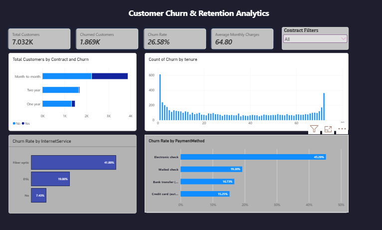

# Customer Churn Analysis and Prediction

## Project Overview

Customer churn is a key business challenge for subscription-based companies. This project analyzes historical customer data to identify churn patterns, develop an interactive Power BI dashboard, and build machine learning models that estimate the likelihood of customer churn.

The project combines data cleaning, exploratory data analysis, SQL business analysis, Power BI visualization, and predictive modeling into an end-to-end analytics workflow.

## Business Objectives

- Measure customer churn and retention.
- Analyze churn across contract types, tenure groups, payment methods, and service categories.
- Identify customer segments that may need additional retention attention.
- Compare classification models for customer churn prediction.
- Communicate findings through visualizations and measurable evaluation results.

## Technology Stack

- **Programming:** Python
- **Data Analysis:** Pandas, NumPy
- **Visualization:** Matplotlib, Seaborn, Power BI
- **Database and Queries:** MySQL
- **Machine Learning:** Scikit-learn
- **Model Persistence:** Joblib
- **Development:** Jupyter Notebook, Visual Studio Code

## Project Workflow

1. **Data Cleaning:** Inspected data types, handled blank `TotalCharges` values, checked duplicates, and saved a cleaned dataset.
2. **Exploratory Data Analysis:** Examined churn distribution and compared churn rates across customer characteristics.
3. **SQL Business Analysis:** Used filtering, aggregation, conditional logic, CTEs, and window functions to answer business questions.
4. **Power BI Dashboard:** Developed KPI cards, churn breakdowns, and interactive customer-segment filters.
5. **Machine Learning:** Prepared features, encoded categorical variables, trained classification models, and evaluated their performance.
6. **Model Evaluation:** Compared accuracy, precision, recall, F1-score, ROC-AUC, and confusion matrices.

## Dashboard

Add your dashboard screenshot below.

## Machine Learning Models

The project compares a Dummy Classifier baseline, Logistic Regression, and Random Forest.

The models are evaluated using a held-out test set. Final results should be documented from the actual experiment.

| Model | Accuracy | Precision | Recall | F1-score | ROC-AUC |
|---|---:|---:|---:|---:|---:|
| Dummy Classifier | 0.734 | 0.000 | 0.000 | 0.000 | 0.500 |
| Logistic Regression | 0.726 | 0.490 | 0.797 | 0.607 | 0.835 |
| Random Forest | 0.784 | 0.622 | 0.476 | 0.539 | 0.812 | 

## Repository Structure

- `data/` — Raw and processed data, if permitted for redistribution
- `notebooks/` — Data cleaning, EDA, and model development
- `sql/` — SQL data-quality checks and business analysis queries
- `models/` — Saved model pipeline, if included
- `reports/` — Dashboard, model metrics, and charts
- `src/` — Reusable prediction script

## How to Run

1. Clone the repository.
2. Create and activate a Python virtual environment.
3. Install the required packages with `python -m pip install -r requirements.txt`.
4. Place the cleaned dataset in `data/processed/` according to the project instructions.
5. Run the notebooks in numerical order.
6. Run the prediction script using `python src/predict_churn.py` after generating or downloading the model artifact.

The script expects the trained model at `models/customer_churn_random_forest.joblib`.

## Limitations

- Results depend on the dataset and its historical customer population.
- Observed associations do not establish causal relationships.
- The dataset does not provide a cancellation date for calendar-based churn trend analysis.
- Model probabilities require additional calibration assessment before being interpreted as reliable real-world risk estimates.
- Performance on new customer populations may differ from performance on the held-out test set.

## Future Improvements

- Tune classification thresholds based on retention campaign costs.
- Perform cross-validation and hyperparameter tuning.
- Evaluate probability calibration and monitor model drift.
- Develop a prediction interface for authorized users.
- Test retention strategies using appropriate experiments.

